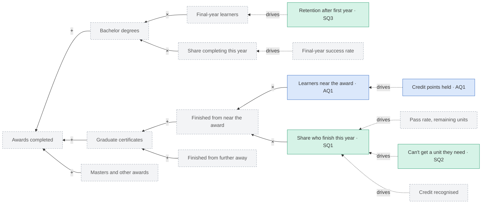

# Learning and teaching: a goal, its questions and their measures

_[← Initiatives](../README.md)_

One goal for the area, as its owner states it; the questions that show whether it's being met; and a
measure for each question, placed in a tree that shows how the measures make one another. This is
Goal–Question–Metric (Basili and Weiss, 1984), with the measures laid out as a metric tree.

The data team keeps it with the goal's owner, to see which questions nobody has asked yet and suggest
them first. A suggestion is only that: nothing is built for it until its owner says yes in a ticket and
it becomes a question in [Analytics' records](../analytics-questions.md).

## The goal

| | |
| -- | -- |
| **Goal** | **More learners finish the award they started** |
| Owner | Clara Jensen, Planning |
| What for | To put advising, units and support where they keep learners on track |
| Seen from | Planning's side, faculty by faculty, from one census to the next |
| Seeded from | The measures the whole sector reports: completions, retention and success, as the Department of Education publishes them from TCSI |

## The tree

Each measure makes the one its arrow points to. A solid arrow is a formula: the measures add (+) or
multiply (×) to make the next one, so a change splits between them exactly. A dotted arrow is a driver:
it moves the next measure with no formula, so it's a hypothesis, checked in the data. Blue is answered,
green is suggested, and grey is a starter: a measure the sector reports that nobody has asked about yet.

## The questions

| ID | The question | Its measure | Where it stands |
| -- | ------------ | ----------- | --------------- |
| `AQ1` | **How many learners are within 15 credit points of a graduate certificate, by faculty, as at census date?** | Learners near the award, and the credit points they hold | Asked by Clara Jensen and answered, ticket `DATA-142` |
| `SQ1` | **Of the learners near a graduate certificate at census, how many finish within the year?** | Share who finish this year | Suggested to Clara Jensen, no answer yet |
| `SQ2` | **How many learners near an award can't get a unit they need next term, by faculty?** | Can't get a unit they need | Suggested to Clara Jensen, for Planning and the faculties, no answer yet |
| `SQ3` | **Of last year's new bachelor learners who didn't finish, how many came back this year, by faculty?** | Retention after first year | Suggested to Clara Jensen, no answer yet |

The grey measures are suggested only once the data team can say which decision each would inform.

## What each suggestion says

| ID | Why now | The decision it informs | Size, when suggested |
| -- | ------- | ----------------------- | -------------------- |
| `SQ1` | Planning puts advising where learners are near an award at census. This shows whether it worked, faculty by faculty. | Where to put advising next census | Small: the date each award is conferred, beside what's already counted |
| `SQ2` | It warns before census, while there's still time to put a unit on. Counts only, no names, as `BR3` asks of `AQ1` in [Census planning 2026](../census-planning-2026.md). | Which units to run next term | Medium: learners' study plans and the units on offer, neither read yet |
| `SQ3` | It's the sector's own retention rate, which the Department of Education publishes for every university, so the definition exists. | Where to put first-year support | Small: enrolments, year on year |

## How a suggestion moves

1. **Suggested.** The data team picks a branch nobody has asked about, writes it as a question with why
   now, the decision it informs and its size, and sends it to the goal's owner. It takes the next `SQ`
   number here.
2. **Yes, or not now.** A yes opens a ticket in the owner's words, with who checks the result, and the
   question takes the next `AQ` number in [Analytics' records](../analytics-questions.md), marked as
   suggested by the data team. A "not now" stays here, with the reason and when to ask again.
3. **Then as any question.** It follows [From a question to the code](../README.md#from-a-question-to-the-code).

## Rules for the tree

- One goal at the top, and three to five levels below it.
- A measure is in the tree because a question needs it or the sector reports it, never because it's
  easy to count.
- Once both ends of a solid arrow are built, a test checks the formula. A driver is checked again in the
  data each census.
- No target on a measure that explains another: a measure made a target stops measuring.
- Each term, the data team counts the questions it suggested and how many their owners accepted. That's
  a measure for the team, never a target for one person.
