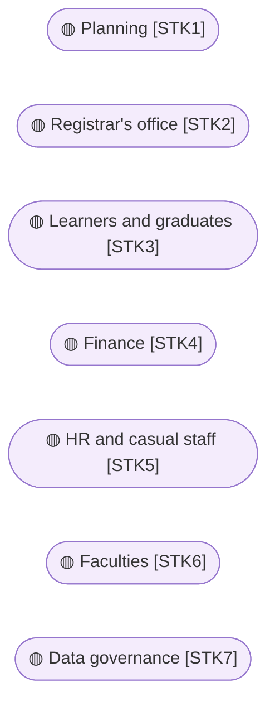
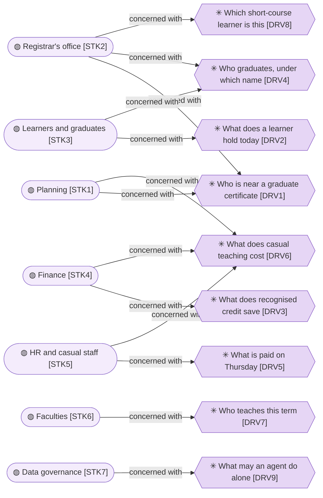
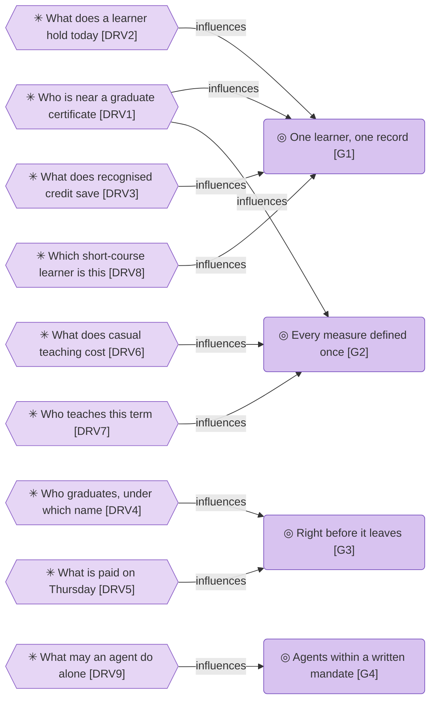
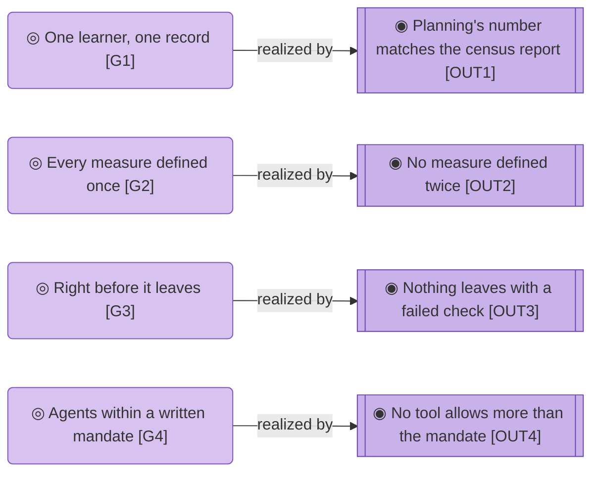
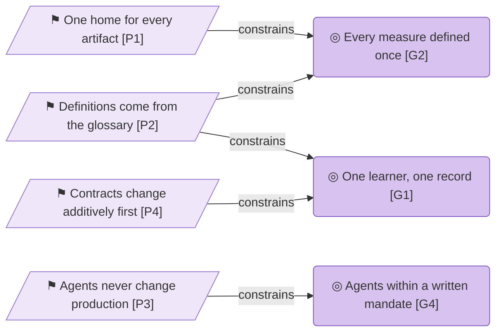

# Motivation

_[← Strategy layer](./README.md) · [Front door](../README.md)_

Who has a stake in the university's data, the questions they need answered,
what must become true for those answers to hold, and the principles every
change is tested against.

**ArchiMate viewpoint:** Motivation: Stakeholder, Driver, Goal, Outcome,
Principle.

**Status:** ◐ Draft catalogue — identified from the data products and the
example project's files named in each row, not yet confirmed.

## Stakeholders

Seven groups ask the questions below. Research, engagement and campus services
hold data too, and ask nothing here yet.

| ID | Stakeholder | What they want | Source |
| -- | ----------- | -------------- | ------ |
| `STK1` | **Planning**, led for these questions by Clara Jensen | Numbers they can plan support and teaching from, that match the census report | `20-data-governance/4-data-products/learners_near_an_award.yml` |
| `STK2` | **Registrar's office**, Mei Tanaka for the learner record | One record per learner, and names and credentials right before anything is printed or sent | `20-data-governance/4-data-products/learner_records.yml` |
| `STK3` | **Learners and graduates** | To see what they hold, how close they are to an award, and their name printed as they write it | `20-data-governance/4-data-products/learner_wallet.yml` |
| `STK4` | **Finance**, Rohan Desai for teaching cost | One meaning for each cost, defined once and read the same in every tool | `20-data-governance/4-data-products/casual_teaching_cost.yml` |
| `STK5` | **HR and casual staff**, Ingrid Holm for pay | Every approved claim paid right, on the Thursday, and news sent only to those who asked for it | `20-data-governance/4-data-products/hours_to_pay.yml` |
| `STK6` | **Faculties**, Anil Kurian for Health | To know who teaches in each school this term, and how many are casual | `20-data-governance/4-data-products/teaching_workload.yml` |
| `STK7` | **Data governance**, Yusuf Demir as lead | Words that mean one thing, an owner for every piece of data, and agents held to what they may do | `20-data-governance/README.md` |

## Drivers: the questions

Each driver is a question from Analytics' records, under the same number there
([`00-initiatives/analytics-questions.md`](../../../00-initiatives/analytics-questions.md)), brought in by an initiative's ticket.
Nothing else is modelled: a question nobody asked has no driver, so it has no capability, service or data object below it
either. `DRV6` is three stakeholders' question, because the one name meant three different sums.

| ID | Driver: the question | Asked by | Source |
| -- | -------------------- | -------- | ------ |
| `DRV1` | **How many learners are within 15 credit points of a graduate certificate, by faculty, as at census date?** | Planning | `20-data-governance/4-data-products/learners_near_an_award.yml` |
| `DRV2` | **Which credentials does a learner hold today, and how close are they to their award?** | The wallet app, for learners | `20-data-governance/4-data-products/learner_wallet.yml` |
| `DRV3` | **How much tuition does recognised credit save learners, by award and faculty?** | Finance | `20-data-governance/4-data-products/tuition_forgone.yml` |
| `DRV4` | **Who graduates at each ceremony, with which award, and under which printed name?** And is every report about a name answered within two days? | The registrar's and graduations offices | `20-data-governance/4-data-products/graduation_list.yml` |
| `DRV5` | **Which approved claims are paid on the coming pay day, and for how much?** | HR, for payroll | `20-data-governance/4-data-products/hours_to_pay.yml` |
| `DRV6` | **What does the casual teaching in a teaching period cost?** Finance, HR and Planning each meant a different sum by the same words | Finance, HR, Planning | `20-data-governance/4-data-products/casual_teaching_cost.yml` |
| `DRV7` | **How many people teach in each school this term, and how many are casual?** | The Faculty of Health | `20-data-governance/4-data-products/teaching_workload.yml` |
| `DRV8` | **Which learner is a short-course enrolment that came with no email?** And may HR send its tutoring news only to tutors who said yes? | The learning team, HR | `20-data-governance/4-data-products/short_course_follow_ups.yml` |
| `DRV9` | **What may an AI agent do on its own, where, and who answers for it?** | Data governance | `20-data-governance/8-mandates/README.md` |

## Goals

- **G1 — One learner, one record.** Every system that knows a learner
  points at the same learner, with one key, so Planning, the wallet and
  Finance count the same people. Source:
  `30-data-project/models/core/student/_student__conceptual.yml`.
- **G2 — Every measure defined once.** A measure has one name, one meaning
  and one owner, written in the business glossary and in an open semantic
  format, and every tool reads that one definition. Source:
  `20-data-governance/11-metrics/README.md`.
- **G3 — Right before it leaves.** Pay, printed names and files for other
  systems are checked before they leave the university, not after somebody
  complains. Source: `30-data-project/exposures/graduations/`.
- **G4 — Agents within a written mandate.** An agent drafts and finds causes;
  a person approves; and anything it may do alone is written down, signed and
  enforced. Source: `20-data-governance/8-mandates/README.md`.

## Outcomes

Every outcome is checked on every pull request, by the file in its row.

| ID | Outcome | How it is checked | Source |
| -- | ------- | ----------------- | ------ |
| `OUT1` | **Planning's number matches the census report**, faculty by faculty | `30-data-project/tests/reconciliation/` and `30-data-project/scripts/check/check_metric.py` | `30-data-project/README.md` |
| `OUT2` | **No measure is defined twice**: each one in the dbt project or on the platform has its definition in `20-data-governance/11-metrics/` | `30-data-project/scripts/check/metrics.py` | `20-data-governance/11-metrics/README.md` |
| `OUT3` | **Nothing leaves with a failed check**: the graduation list, the certificates file and the pay export are built only when their tests pass | `30-data-project/exposures/` and the scorecard, `30-data-project/docs/scorecard.md` | `30-data-project/docs/scorecard.md` |
| `OUT4` | **No tool allows an agent more than its mandate** | `30-data-project/scripts/check/mandates.py` | `20-data-governance/8-mandates/README.md` |

## Principles

- **P1 — One home for every artifact.** Each artifact has exactly one home
  and an owner; every other place keeps a copy synced one way from it, with a
  check that flags drift. Source:
  `20-data-governance/3-architecture-map/1-motivation/principles/one-home-for-every-artifact.yml`.
- **P2 — Definitions come from the glossary.** A term the business glossary
  holds is copied from it, with its source, never written again in the code.
  Source: `20-data-governance/1-glossary/business-glossary.yml`.
- **P3 — Agents never change production.** In production an agent only reads,
  with personal and sensitive data masked, finds the cause and drafts; a person
  approves, and the release, a plain job, makes the change. Source:
  `30-data-project/AGENTS.md`.
- **P4 — Contracts change additively first.** A canonical table's contract
  gains what is new before anything is taken away, and a breaking change is a
  new version. Source: `20-data-governance/5-data-contracts/`.
