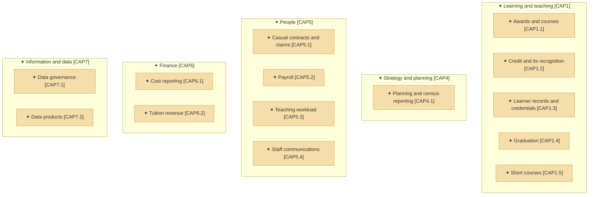

# Capabilities

_[← Strategy layer](./README.md) · [Front door](../README.md)_

What the university must be able to do: every area at level 1, and below that
only the capabilities the questions in [Motivation](./1_motivation.md) need.

**ArchiMate viewpoint:** Strategy: Capability.

**Status:** ◐ Draft catalogue — the level-1 areas adopted from the families
of CAUDIT's Higher Education Reference Model (HERM); the level-2 capabilities
identified from the data products named in each row. Not yet confirmed.

## Level 1 — the areas

The whole university, at one level. The three dashed areas hold data the
project reads (research candidatures, alumni, systems) and are not broken down:
no question here needs them yet.

| ID | Capability (level 1) | What it covers | Detailed below | Source |
| -- | -------------------- | -------------- | -------------- | ------ |
| `CAP1` | **Learning and teaching** | Awards and courses, admission and enrolment, records and credentials, assessment, graduation | Yes | adopted — HERM's Learning and Teaching family |
| `CAP2` | **Research** | Research candidatures, supervision, grants, outputs | No: no question here | adopted — HERM's Research family |
| `CAP3` | **Engagement and advancement** | Alumni, partners, the community | No: no question here | adopted — HERM's engagement capabilities |
| `CAP4` | **Strategy and planning** | Planning, performance and statutory reporting | Yes | adopted — HERM's Strategy and Governance capabilities |
| `CAP5` | **People** | Appointments, contracts, claims, pay, workload | Yes | adopted — HERM's Human Resource Management |
| `CAP6` | **Finance** | Costs, revenue, budgets | Yes | adopted — HERM's Financial Management |
| `CAP7` | **Information and data** | Data governance, data products and the platform they run on | Yes | adopted — HERM's Information Management |
| `CAP8` | **Campus and technology** | Facilities, ICT services | No: no question here | adopted — HERM's Facilities and ICT capabilities |

## Level 2 — only where a question needs it

Each capability here is needed by at least one question; a capability no
question needs is left out, not listed as empty.

| ID | Capability (level 2) | Needed by | Served by | Source |
| -- | -------------------- | --------- | --------- | ------ |
| `CAP1.1` | **Awards and courses**: the awards the university confers, version by version | `DRV1`, `DRV2`, `DRV3` | `BSVC1`, `BSVC2` | `20-data-governance/4-data-products/awards.yml` |
| `CAP1.2` | **Credit and its recognition**: units passed and recognised credentials, counted towards an award | `DRV1`, `DRV3` | `BSVC1`, `BSVC3` | `20-data-governance/4-data-products/learner_records.yml` |
| `CAP1.3` | **Learner records and credentials**: one learner across every system, and what they hold | `DRV1`, `DRV2`, `DRV8` | `BSVC1`, `BSVC2`, `BSVC8` | `20-data-governance/4-data-products/learner_records.yml` |
| `CAP1.4` | **Graduation**: ceremonies, printed names, the certificates file | `DRV4` | `BSVC4` | `20-data-governance/4-data-products/graduation_list.yml` |
| `CAP1.5` | **Short courses**: enrolments that come from outside the student system | `DRV8` | `BSVC8` | `20-data-governance/4-data-products/short_course_follow_ups.yml` |
| `CAP4.1` | **Planning and census reporting** | `DRV1` | `BSVC1` | `20-data-governance/4-data-products/learners_near_an_award.yml` |
| `CAP5.1` | **Casual contracts and claims** | `DRV5`, `DRV6`, `DRV7` | `BSVC5`, `BSVC6`, `BSVC7` | `20-data-governance/4-data-products/claims.yml` |
| `CAP5.2` | **Payroll** | `DRV5` | `BSVC5` | `20-data-governance/4-data-products/hours_to_pay.yml` |
| `CAP5.3` | **Teaching workload** | `DRV7` | `BSVC7` | `20-data-governance/4-data-products/teaching_workload.yml` |
| `CAP5.4` | **Staff communications**, only to those who agreed | `DRV8` | `BSVC9` | `20-data-governance/4-data-products/tutor_newsletters.yml` |
| `CAP6.1` | **Cost reporting** | `DRV6` | `BSVC6` | `20-data-governance/4-data-products/casual_teaching_cost.yml` |
| `CAP6.2` | **Tuition revenue** | `DRV3` | `BSVC3` | `20-data-governance/4-data-products/tuition_forgone.yml` |
| `CAP7.1` | **Data governance**: what words mean, who owns what, who may see what, what agents may do; broken down in data governance's own map | `DRV6`, `DRV9` | `BSVC10` | `20-data-governance/3-architecture-map/2-strategy/capabilities/govern-data.yml` |
| `CAP7.2` | **Data products**: the shared tables and answers, built, tested and released | `DRV1`, `DRV2`, `DRV3`, `DRV4`, `DRV5`, `DRV6`, `DRV7`, `DRV8` | `BSVC11` | `30-data-project/README.md` |
