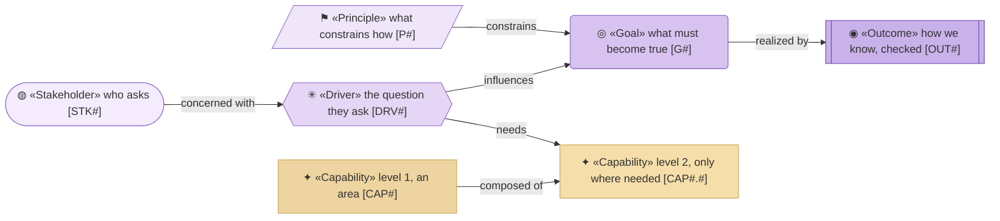
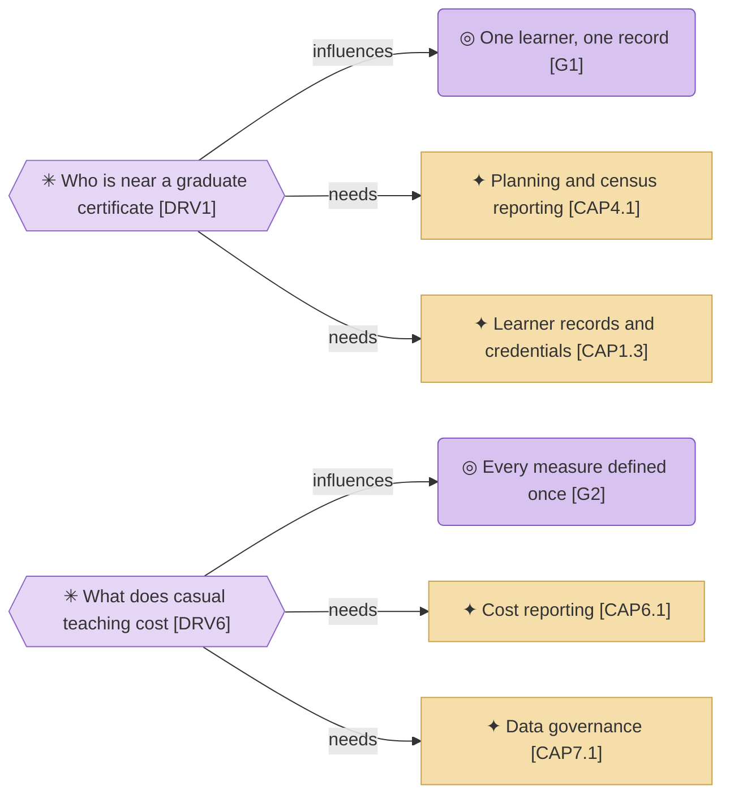

# Strategy & Motivation Layer

_[← Front door](../README.md)_

Who has a stake in the university's data, the questions they ask, and what the
university must be able to do to answer them.

**ArchiMate viewpoint:** Motivation and Strategy: Stakeholder, Driver, Goal,
Outcome, Principle, Capability.

## Documents

| # | Document | Elements | Question it answers |
| - | -------- | -------- | ------------------- |
| 1 | [1_motivation.md](./1_motivation.md) | Stakeholders, Drivers, Goals, Outcomes, Principles | Who asks which question, and what must be true for the answers to hold? |
| 2 | [2_capabilities.md](./2_capabilities.md) | Capabilities, every area at level 1 and level 2 only where a question needs it | What must the university be able to do to answer them? |
| 3 | Value stream | — | Not started: no question here needs one yet |

## Metamodel

Purple is Motivation and tan is Strategy; the darker tan marks a level-1
capability.

## Layer view

The two questions that started the project: Planning's count, which needs one
learner across every system, and the cost three teams called by one name,
which needs a measure defined once.
