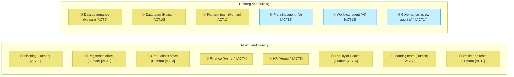
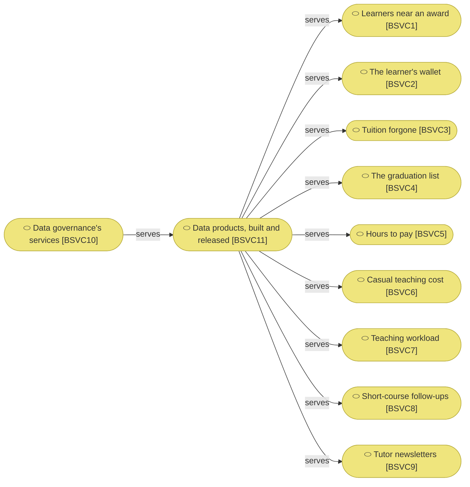

# Actors and services

_[← Business layer](./README.md) · [Front door](../README.md)_

Who takes part in answering the questions, people and AI agents alike, and
the services that hand each answer to whoever asked for it.

**ArchiMate viewpoint:** Business: Business Actor, Business Service.

**Status:** ◐ Draft catalogue — identified from the owner register, the data
products and data governance's map named in each row, not yet confirmed.

## Actors

Cyan is an AI actor. Each agent's role, its steps and how far it may act alone
are on data governance's map, which this model cites rather than restates.

| ID | Actor | Kind | Answers for | Source |
| -- | ----- | ---- | ----------- | ------ |
| `ACT1` | **Planning**: Clara Jensen | Human | Planning's questions and the count near an award | `20-data-governance/2-owners/owners.yml` |
| `ACT2` | **Registrar's office**: Mei Tanaka | Human | The learner record, awards and credentials | `20-data-governance/2-owners/owners.yml` |
| `ACT3` | **Graduations office**: Malia Fonoti | Human | Names to confirm before the printer | `20-data-governance/2-owners/owners.yml` |
| `ACT4` | **Finance**: Rohan Desai | Human | Casual teaching cost and tuition forgone | `20-data-governance/2-owners/owners.yml` |
| `ACT5` | **HR**: Ingrid Holm | Human | Contracts, claims, pay and tutors' consent | `20-data-governance/2-owners/owners.yml` |
| `ACT6` | **Faculty of Health**: Anil Kurian | Human | Who teaches in Health's schools | `20-data-governance/2-owners/owners.yml` |
| `ACT7` | **Learning team** | Human | Short-course enrolments to match | `20-data-governance/2-owners/owners.yml` |
| `ACT8` | **Wallet app team** | Human | What the wallet shows a learner | `20-data-governance/2-owners/owners.yml` |
| `ACT9` | **Data governance**: Yusuf Demir, with Noor, the data architect | Human | The glossary, owners, contracts, mandates and the map | `20-data-governance/README.md` |
| `ACT10` | **Data team**: Jun Park and the analytics engineers | Human | The dbt project: reviewing and building the code | `30-data-project/AGENTS.md` |
| `ACT11` | **Platform team**: Sam | Human | The data platform, and applying each agent's settings | `20-data-governance/2-owners/owners.yml` |
| `ACT12` | **Planning agent**: co-pilot; drafts Planning's changes in development and opens a pull request; escalates to the product owner | AI | Nothing alone: a person approves every change | `20-data-governance/3-architecture-map/5-application/application-components/planning-agent.yml` |
| `ACT13` | **Workload agent**: autonomous with checkpoint, in test only, for one task under a signed mandate; escalates to Anil Kurian | AI | Finding why the night build failed, in test | `20-data-governance/8-mandates/workload-agent.yml` |
| `ACT14` | **Governance review agent**: advisory; reads a pull request against governance's rules and comments; escalates to data governance | AI | Nothing alone: it suggests | `20-data-governance/3-architecture-map/5-application/application-components/governance-review-agent.yml` |

## Business services

One service per answer, each a data product with an owner. All of them are
built by `BSVC11` from definitions `BSVC10` keeps.

| ID | Business service | For | Answers | Realizes | Served by | Data product |
| -- | ---------------- | --- | ------- | -------- | --------- | ------------ |
| `BSVC1` | **Learners near an award** | `ACT1` | `DRV1` | `CAP4.1` | `ACMP13` | `20-data-governance/4-data-products/learners_near_an_award.yml` |
| `BSVC2` | **The learner's wallet** | `ACT8` | `DRV2` | `CAP1.3` | `ACMP13`, `ACMP8` | `20-data-governance/4-data-products/learner_wallet.yml` |
| `BSVC3` | **Tuition forgone** | `ACT4` | `DRV3` | `CAP6.2` | `ACMP13` | `20-data-governance/4-data-products/tuition_forgone.yml` |
| `BSVC4` | **The graduation list**, with names to confirm and name reports | `ACT2`, `ACT3` | `DRV4` | `CAP1.4` | `ACMP13`, `ACMP4` | `20-data-governance/4-data-products/graduation_list.yml` |
| `BSVC5` | **Hours to pay**, and the payroll export | `ACT5` | `DRV5` | `CAP5.2` | `ACMP13`, `ACMP7` | `20-data-governance/4-data-products/hours_to_pay.yml` |
| `BSVC6` | **Casual teaching cost**, one measure for every tool | `ACT4` | `DRV6` | `CAP6.1` | `ACMP12`, `ACMP13` | `20-data-governance/4-data-products/casual_teaching_cost.yml` |
| `BSVC7` | **Teaching workload** | `ACT6` | `DRV7` | `CAP5.3` | `ACMP13` | `20-data-governance/4-data-products/teaching_workload.yml` |
| `BSVC8` | **Short-course follow-ups** | `ACT7` | `DRV8` | `CAP1.5` | `ACMP13` | `20-data-governance/4-data-products/short_course_follow_ups.yml` |
| `BSVC9` | **Tutor newsletters**, to those who agreed | `ACT5` | `DRV8` | `CAP5.4` | `ACMP13` | `20-data-governance/4-data-products/tutor_newsletters.yml` |
| `BSVC10` | **Data governance's services**: defining words, deciding owners, protecting access, writing mandates; each service, its promise and its steps on governance's map | `ACT9` | `DRV6`, `DRV9` | `CAP7.1` | `ACMP14`, `ACMP15`, `ACMP16` | `20-data-governance/3-architecture-map/6-views/services.md` |
| `BSVC11` | **Data products, built and released**: every shared table and answer, tested on each pull request and built every night | `ACT10` | `DRV1`, `DRV5` | `CAP7.2` | `ACMP13`, `ACMP12` | `30-data-project/README.md` |
