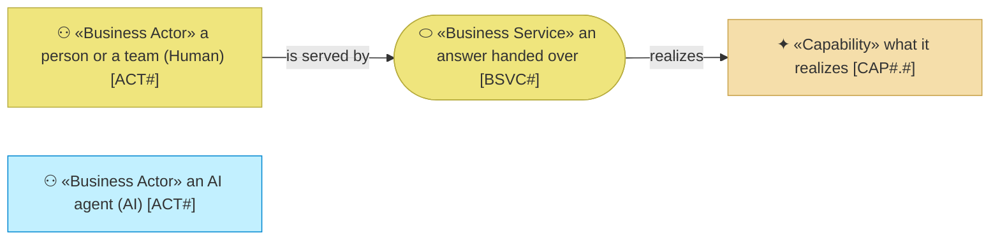
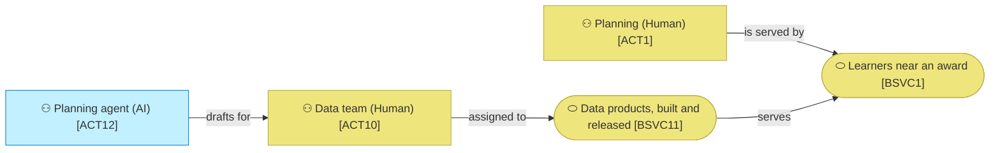

# Business Layer

_[← Front door](../README.md)_

Who takes part in answering the university's questions, and the services that hand each answer over.

**ArchiMate viewpoint:** Business: Business Actor, Business Service.

## Documents

| # | Document | Elements | Question it answers |
| - | -------- | -------- | ------------------- |
| 1 | [1_actors-and-services.md](./1_actors-and-services.md) | Actors, people and AI agents; business services | Who answers for what, and which service hands over each answer? |
| 2 | Process map | — | Not started: the steps of governance's services are on its own map, `20-data-governance/3-architecture-map/3-business/process-steps/` |

## Metamodel

Yellow is Business, cyan an AI actor, and tan the capability a service realizes, visiting from Strategy.

## Layer view

Planning's answer reaches it as a service; the data team builds it, and the planning agent drafts changes a person approves.
