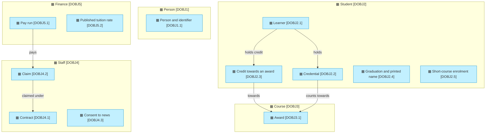

# Data domains and objects

_[← Information layer](./README.md) · [Front door](../README.md)_

The university's data domains, every one at level 1, and inside them only the
data objects the questions need, each with the system it is first recorded in
and the shared table that holds it for everyone else.

**ArchiMate viewpoint:** Information: Data Object, a domain at level 1 and an
object at level 2.

**Status:** ◐ Draft catalogue — the domains adopted from the university's
conceptual model, which follows TCSI; the objects identified from the modelled
entities and the data products named in each row. Not yet confirmed.

## Level 1 — the domains

```mermaid
flowchart TB
  d1["▦ Person [DOBJ1]"]:::application1
  d2["▦ Student [DOBJ2]"]:::application1
  d3["▦ Course [DOBJ3]"]:::application1
  d4["▦ Staff [DOBJ4]"]:::application1
  d5["▦ Finance [DOBJ5]"]:::application1
  d6["▦ Organisation [DOBJ6]"]:::application1
  d7["▦ Admissions [DOBJ7]"]:::application1
  d8["▦ Research [DOBJ8]"]:::application1
  d9["▦ Fees [DOBJ9]"]:::application1

  classDef application1 fill:#9adcf0,stroke:#0288d1,color:#333
  classDef quiet fill:#e8f7fd,stroke:#0288d1,color:#777,stroke-dasharray: 4 3
  class d6,d7,d8,d9 quiet
```

Every domain the university holds data in. The four dashed domains are named
so the map is whole; no question here needs their objects yet, so none are
listed.

| ID | Data domain | Owner | Detailed below | Source |
| -- | ----------- | ----- | -------------- | ------ |
| `DOBJ1` | **Person**: the person behind a learner, an applicant or a staff member | Registrar's office | Yes | `30-data-project/models/_shared/_shared__conceptual.md` |
| `DOBJ2` | **Student**: learners, what they hold and what counts towards an award | Registrar's office | Yes | `30-data-project/models/_shared/_shared__conceptual.md` |
| `DOBJ3` | **Course**: awards, courses, units and teaching periods | Registrar's office, with the faculties | Yes | `30-data-project/models/_shared/_shared__conceptual.md` |
| `DOBJ4` | **Staff**: appointments, contracts and claims | HR | Yes | `30-data-project/models/_shared/_shared__conceptual.md` |
| `DOBJ5` | **Finance**: costs, pay and published rates | Finance | Yes | `30-data-project/models/marts/finance/_finance__conceptual.md` |
| `DOBJ6` | **Organisation**: faculties, schools, campuses | Planning | No: read as names only | `30-data-project/models/_shared/_shared__conceptual.md` |
| `DOBJ7` | **Admissions**: applicants, applications, offers | Admissions office | No: no question here | `30-data-project/models/_shared/_shared__conceptual.md` |
| `DOBJ8` | **Research**: candidatures and supervision | Graduate research school | No: no question here | `30-data-project/models/_shared/_shared__conceptual.md` |
| `DOBJ9` | **Fees**: student fees, loans, scholarships | Finance | No: no question here | `30-data-project/models/_shared/_shared__conceptual.md` |

## Level 2 — only the objects a question needs

Each object has one system it is first recorded in. Every other place,
the shared tables included, keeps a copy, synced one way from there.
Its governance, its owner, steward, class and contract, is in data
governance's information assets, `20-data-governance/9-information-assets/`.

| ID | Data object | Needed by | Recorded first in | Shared table | Source |
| -- | ----------- | --------- | ----------------- | ------------ | ------ |
| `DOBJ1.1` | **Person and identifier**: one person, known by each system's key | `DRV1`, `DRV8` | `ACMP1` | `30-data-project/models/core/person/` (conceptual only) | `30-data-project/models/core/person/_person__conceptual.yml` |
| `DOBJ2.1` | **Learner**: anyone who has learned with the university, in any system | `DRV1`, `DRV2`, `DRV8` | `ACMP1` | `30-data-project/models/core/student/core_learner.sql` | `20-data-governance/5-data-contracts/core_learner_v1.yaml` |
| `DOBJ2.2` | **Credential**: an award conferred, a micro-credential or a badge | `DRV2` | `ACMP1` | `30-data-project/models/core/student/core_credential_v2.sql` | `20-data-governance/5-data-contracts/core_credential_v2.yaml` |
| `DOBJ2.3` | **Credit towards an award**: units passed and recognised credentials | `DRV1`, `DRV3` | `ACMP1` | `30-data-project/models/core/student/core_credit_towards_award.sql` | `20-data-governance/5-data-contracts/core_credit_towards_award_v1.yaml` |
| `DOBJ2.4` | **Graduation and printed name**: a ceremony place, and the name a graduate confirmed in the portal | `DRV4` | `ACMP1` | `30-data-project/models/marts/graduations/` | `20-data-governance/4-data-products/graduation_list.yml` |
| `DOBJ2.5` | **Short-course enrolment** | `DRV8` | `ACMP3` | `30-data-project/models/marts/learning/` | `20-data-governance/4-data-products/short_course_follow_ups.yml` |
| `DOBJ3.1` | **Award**: what the university confers, and the credit points it needs, version by version | `DRV1`, `DRV2`, `DRV3` | `ACMP1` | `30-data-project/models/core/course/core_award.sql` | `20-data-governance/5-data-contracts/core_award_v1.yaml` |
| `DOBJ4.1` | **Contract**: a staff member's contract, casual or not, version by version | `DRV7` | `ACMP5` | `30-data-project/models/marts/workload/` | `20-data-governance/4-data-products/teaching_workload.yml` |
| `DOBJ4.2` | **Claim**: the hours a casual staff member claims, as it stands now | `DRV5`, `DRV6` | `ACMP6` | `30-data-project/models/core/staff/core_claim.sql` | `20-data-governance/5-data-contracts/core_claim_v1.yaml` |
| `DOBJ4.3` | **Consent to news**: a tutor's yes to HR's news of tutoring work | `DRV8` | `ACMP5` | `30-data-project/models/marts/hr/` | `20-data-governance/4-data-products/tutor_newsletters.yml` |
| `DOBJ5.1` | **Pay run**: what is paid on a pay day, from approved claims | `DRV5`, `DRV6` | `ACMP7` | `30-data-project/models/marts/payroll/` | `20-data-governance/4-data-products/hours_to_pay.yml` |
| `DOBJ5.2` | **Published tuition rate**: Finance's published rates, kept as reference data in the project | `DRV3` | `ACMP13` | `30-data-project/seeds/reference/finance/tuition_rates.csv` | `20-data-governance/4-data-products/tuition_forgone.yml` |
