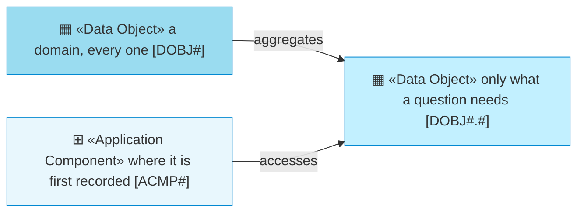
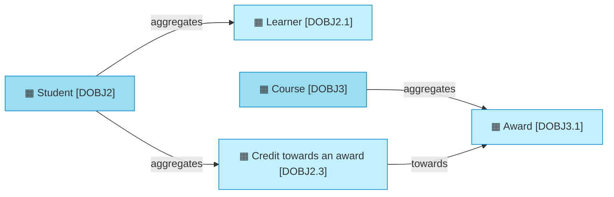

# Information Layer

_[← Front door](../README.md)_

The university's data domains and the objects inside them that the questions need.

**ArchiMate viewpoint:** Information: Data Object, a domain at level 1 and an object at level 2.

## Documents

| # | Document | Elements | Question it answers |
| - | -------- | -------- | ------------------- |
| 1 | [1_data-domains-and-objects.md](./1_data-domains-and-objects.md) | Data domains, every one; data objects, only where a question needs them | What information exists, who owns it, and where is it first recorded? |
| 2 | Classification and retention | — | Not started here: each object's class and level are data governance's, in `20-data-governance/9-information-assets/` |

## Metamodel

The darker cyan marks a data domain; the pale box is a system visiting from the Application layer.

## Layer view

Planning's question in data: a learner's credit, counted towards an award.
