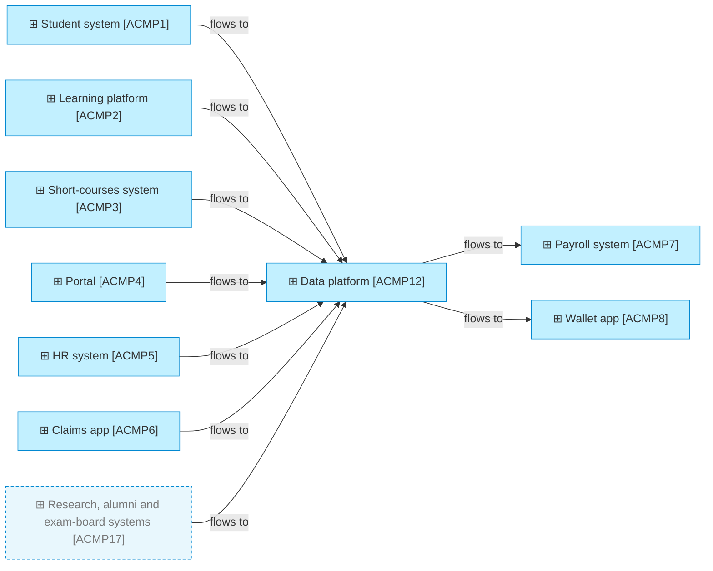
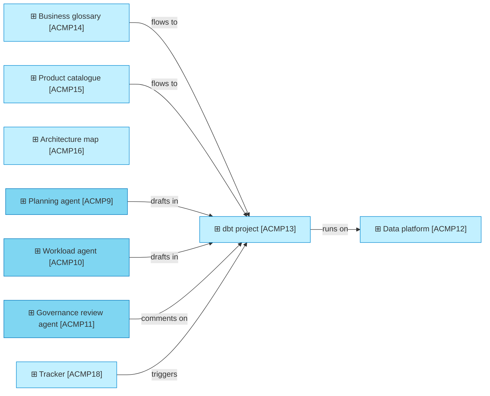

# Realization register

_[← Application layer](./README.md) · [Front door](../README.md)_

Which software records the data and serves each business service, and where
each one is specified. The systems the university buys are named, never
designed.

**ArchiMate viewpoint:** Application usage: Application Component.

**Status:** ◐ Draft catalogue — identified from the project's sources, its
agents and data governance's map, named in each row. Not yet confirmed.

## Systems that record the data

Each system's data lands on the platform every night; the payroll system and
the wallet app read back what the project builds. The dashed systems send data
no question here needs beyond a learner's or a person's key.

| ID | Application component | Serves | Specification | Realized by |
| -- | --------------------- | ------ | ------------- | ----------- |
| `ACMP1` | **Student system**: learners, awards, enrolments, graduations | `BSVC1`, `BSVC2`, `BSVC3`, `BSVC4` | The vendor's; the project reads it as a source | `30-data-project/sources/student_system/` |
| `ACMP2` | **Learning platform**: accounts and badges | `BSVC2` | The vendor's | `30-data-project/sources/learning_platform/` |
| `ACMP3` | **Short-courses system** | `BSVC8` | The vendor's | `30-data-project/sources/short_courses/` |
| `ACMP4` | **Portal**: name confirmations and name reports | `BSVC4` | The university's own | `30-data-project/sources/portal/` |
| `ACMP5` | **HR system**: staff, contracts, tutors' wishes | `BSVC7`, `BSVC9` | The vendor's; its interface agreed team to team | `30-data-project/examples/hr-system-interface/` |
| `ACMP6` | **Claims app**: casual staff's claims | `BSVC5`, `BSVC6` | The university's own | `30-data-project/sources/claims_app/` |
| `ACMP7` | **Payroll system**: pays on the Thursday | `BSVC5` | The vendor's; reads the project's export | `30-data-project/exposures/payroll/` |
| `ACMP8` | **Wallet app**: what a learner sees | `BSVC2` | The wallet app team's | `30-data-project/exposures/wallet/` |
| `ACMP17` | **Research, alumni and exam-board systems** | `BSVC11` | The vendors' | `30-data-project/sources/research_system/`, `30-data-project/sources/alumni_system/`, `30-data-project/sources/exam_boards/` |

## The data team's and data governance's tools

Definitions flow one way, from the glossary and the catalogue into the dbt
project, which runs on the platform. Agents draft in the project, in
development or test, and never change production.

| ID | Application component | Serves | Specification | Realized by |
| -- | --------------------- | ------ | ------------- | ----------- |
| `ACMP9` | **Planning agent** | `BSVC11` | Its role's steps on governance's map | `30-data-project/agents/planning-agent/` |
| `ACMP10` | **Workload agent** | `BSVC11` | Its signed mandate | `30-data-project/agents/workload-agent/` |
| `ACMP11` | **Governance review agent** | `BSVC10` | Its skill | `30-data-project/skills/review-for-governance/` |
| `ACMP12` | **Data platform**: Databricks and Unity Catalog; tables, tags, masks, metric views | `BSVC6`, `BSVC11` | The platform team's | `30-data-project/databricks.yml` |
| `ACMP13` | **dbt project**: every shared table and answer, with its tests | `BSVC1`, `BSVC2`, `BSVC3`, `BSVC4`, `BSVC5`, `BSVC6`, `BSVC7`, `BSVC8`, `BSVC9`, `BSVC11` | `30-data-project/AGENTS.md` | `30-data-project/` |
| `ACMP14` | **Business glossary**: what the university's words mean; the platform keeps a synced copy | `BSVC10` | `20-data-governance/1-glossary/README.md` | `20-data-governance/1-glossary/` |
| `ACMP15` | **Product catalogue**: data products and enterprise contracts, in open standards | `BSVC10` | `20-data-governance/7-standards/README.md` | `20-data-governance/4-data-products/`, `20-data-governance/5-data-contracts/` |
| `ACMP16` | **Architecture map**: this model, and governance's part of it in detail | `BSVC10` | This model's front door | `10-enterprise-architecture/architecture/`, `20-data-governance/3-architecture-map/` |
| `ACMP18` | **Tracker**: where business users ask and approve, in tickets linked to pull requests | `BSVC11` | The data team's | Pending — future initiative: tickets are described in `30-data-project/docs/process.md`, with no tracker in the repository |
