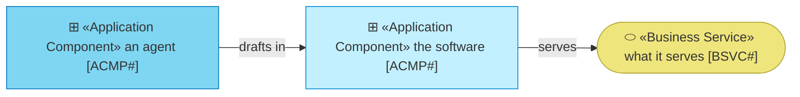
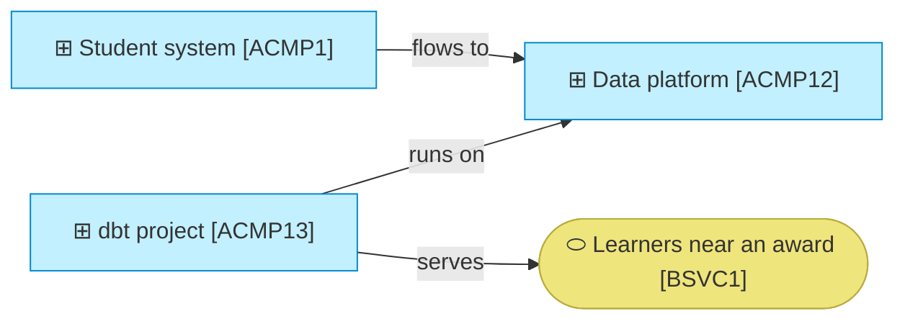

# Application Layer

_[← Front door](../README.md)_

Which software records the data and serves each business service.

**ArchiMate viewpoint:** Application usage: Application Component.

## Documents

| # | Document | Elements | Question it answers |
| - | -------- | -------- | ------------------- |
| 1 | [1_realization-register.md](./1_realization-register.md) | Application components: the systems, the data team's tools, the agents | Which software serves each answer, and where is it specified? |

## Metamodel

The darker cyan marks an agent; the yellow service visits from the Business layer.

## Layer view

The student system's data lands on the platform, where the dbt project builds Planning's answer.
