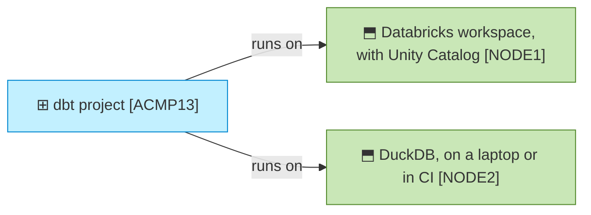
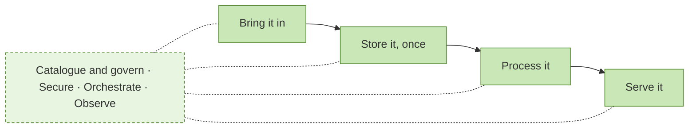

# Platforms

_[← Technology layer](./README.md) · [Front door](../README.md)_

Where the data runs, only where an answer depends on it.

**ArchiMate viewpoint:** Technology: Node.

**Status:** ◐ Draft catalogue — identified from the project's targets, not
yet confirmed.

## Nodes

The same code runs on both. Only one carries business facts: masking personal
data by its class, and a measure defined once as a metric view, need Unity
Catalog.

| ID | Node | Why the business cares | Realized by |
| -- | ---- | ---------------------- | ----------- |
| `NODE1` | **Databricks workspace, with Unity Catalog** | Personal data is masked for everyone outside the group allowed to read it, and casual teaching cost and casual pay paid are metric views every tool reads | `30-data-project/databricks.yml`, `30-data-project/docs/databricks-governance.md` |
| `NODE2` | **DuckDB, on a laptop or in CI** | Anyone can run the whole project and every test with no account | `30-data-project/profiles.yml` |

## The platform's parts, each with a date and a way out

What a data platform has to do stays much the same while products change:
four parts follow the data, and four run across all of them. Each part has a
product under it, a date to look at it again, and a seam: something both sides
agree on, behind which the product can be replaced and nothing in front of it
has to change. Where there is no seam, leaving has a cost, written down here
so it is chosen, not found.

| Part | What does it here | Realized by | Look again by | The seam, or what leaving costs |
| ---- | ----------------- | ----------- | ------------- | ------------------------------- |
| **Bring it in** | A Lakeflow pipeline loads each system's nightly files, and keeps out and counts rows with no key | `30-data-project/scripts/setup/loading_pipeline.sql` | June 2027 | The systems' files, in the formats each interface agrees; the HR system's is `30-data-project/examples/hr-system-interface/` |
| **Store it, once** | Tables in Unity Catalog, kept in the university's own cloud storage | `30-data-project/databricks.yml` | June 2027 | Delta Lake, an open table format: any engine that knows it reads the tables |
| **Process it** | The dbt project builds every shared table and answer, with its tests | `30-data-project/dbt_project.yml` | March 2027, with each dbt release | The logic is SQL in the university's repository, and the same code runs on DuckDB |
| **Serve it** | Metric views and the marts, read by dashboards, the wallet app and the payroll export | `30-data-project/exposures/` | June 2027 | Each measure is defined in Apache Ossie, `20-data-governance/11-metrics/`; each product in the Open Data Product Standard, `20-data-governance/6-product-descriptors/` |
| **Catalogue and govern** | Unity Catalog's tags, masks and synced glossary terms | `30-data-project/docs/databricks-governance.md` | June 2027 | The glossary, owners, assets and contracts are kept outside the platform, in `20-data-governance/`, and synced to it |
| **Secure** | The university's directory for who is who, groups and grants, and a mask on direct personal data | `30-data-project/docs/databricks-governance.md` | June 2027 | Groups, never people, are granted; each column's class is in the model's YAML, so the masks can be set again on another platform |
| **Orchestrate** | Lakeflow Jobs, deployed as one bundle to test and production | `30-data-project/resources/` | June 2027 | Lock-in, chosen: the schedules are the product's own; the jobs are files in the repository, so they can be written again |
| **Observe** | Each night's checks kept in `check_results`, the scorecard, and the platform's monitors and system tables | `30-data-project/docs/every-week.md` | June 2027 | Lock-in, chosen: the monitors and alerts are the product's own; the checks' results are a table the project keeps |
