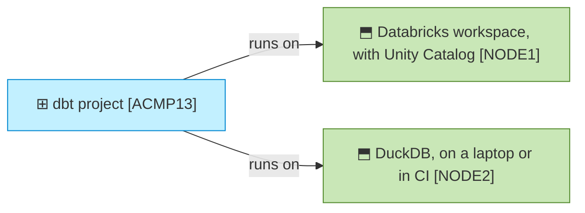

# Platforms

_[← Technology layer](./README.md) · [Front door](../README.md)_

Where the data runs, only where an answer depends on it.

**ArchiMate viewpoint:** Technology: Node.

**Status:** ◐ Draft catalogue — identified from the project's targets, not
yet confirmed.

## Nodes

The same code runs on both. Only one carries business facts: masking personal
data by its class, and a measure defined once as a metric view, need Unity
Catalog.

| ID | Node | Why the business cares | Realized by |
| -- | ---- | ---------------------- | ----------- |
| `NODE1` | **Databricks workspace, with Unity Catalog** | Personal data is masked for everyone outside the group allowed to read it, and casual teaching cost and casual pay paid are metric views every tool reads | `30-data-project/databricks.yml`, `30-data-project/docs/databricks-governance.md` |
| `NODE2` | **DuckDB, on a laptop or in CI** | Anyone can run the whole project and every test with no account | `30-data-project/profiles.yml` |
