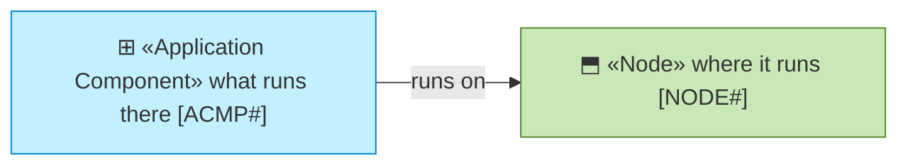
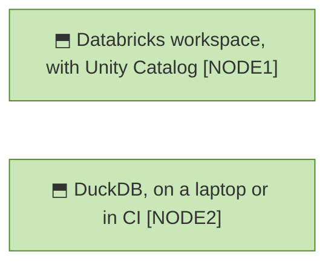

# Technology Layer

_[← Front door](../README.md)_

Where the data runs, only where an answer depends on it.

**ArchiMate viewpoint:** Technology: Node.

## Documents

| # | Document | Elements | Question it answers |
| - | -------- | -------- | ------------------- |
| 1 | [1_platforms.md](./1_platforms.md) | Nodes | Where does it run, and why does the business care? |

## Metamodel

Green is Technology; the cyan component visits from the Application layer.

## Layer view

Two places, one codebase.
