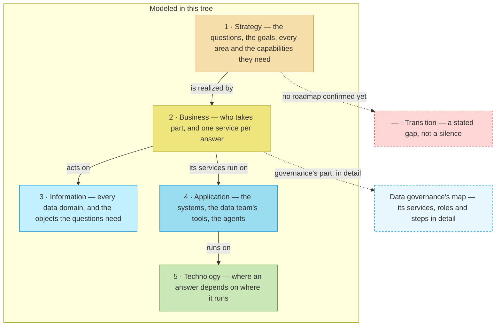

# Architecture — the university, for the questions its data answers

_The front door of this model. This folder's rules: [`AGENTS.md`](../AGENTS.md)._

What the university knows about itself, for the questions its data has to
answer: who asks them, what it must be able to do, who takes part, which
information it holds, and which software records and serves it.

**Federation ID:** `UNI`. Data governance's map cites this model's elements as
`UNI.<ID>`. Every relationship between peers is declared once, in
[`relationships.md`](./relationships.md).

## What is modeled, and what is not

Wide at the top, narrow below. Every area and every data domain of the
university is named; below them, only what one of the questions in
[Motivation](./1_strategy/1_motivation.md) needs. The dashed boxes are where
the model stops: data governance details its own part, and no roadmap has
been confirmed.

| # | Layer | The question it answers | Status |
| - | ----- | ----------------------- | ------ |
| 0 | Business design | Who are the customers, and how does each offering pay? | `Out of scope` — the questions are about the university's data, not its business model |
| 1 | [Strategy](./1_strategy/README.md) | Why does this exist, and what must it be able to do? | `Local` — the questions as drivers; every area at level 1 |
| 2 | [Business](./2_business/README.md) | Who does what, and which services are offered? | `Local` — actors and one service per answer; governance's roles and steps are `External` — owned by `20-data-governance/3-architecture-map/` |
| 3 | [Information](./3_information/README.md) | What information exists, and where does it live? | `Local` — every data domain, and the objects the questions need; their governance is `External` — owned by `20-data-governance/9-information-assets/` |
| 4 | [Application](./4_application/README.md) | Which software realizes each business service? | `Local` — the register |
| 5 | [Technology](./5_technology/README.md) | What runs it all? | `Local` — two nodes |
| — | Transition | Where is this going, and in what order? | `Gap` — current state only |

Domains stay unused at Depth 2; see [`AGENTS.md`](../AGENTS.md).

## How far each document has been validated

| Mark | Meaning |
| ---- | ------- |
| `○` | Not started — the document exists so the gap is visible |
| `◐` | Draft catalogue — identified and written down; nobody has confirmed it |
| `●` | Validated — the Requester has read it and stands behind it, since a date |

Every document is `◐` today: the university and its people are fictional, so
nobody can confirm it but the author of the films.
