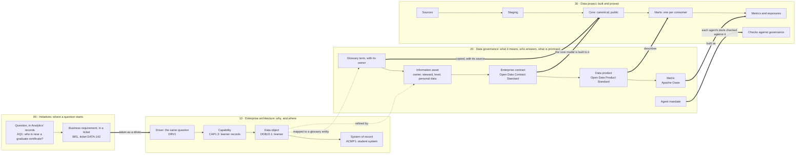
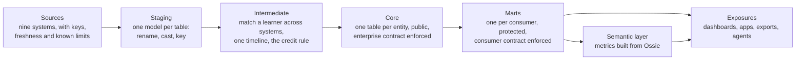

# The university's data, end to end

The example behind the [Learning Data](https://data.learn-all.org/) films: one fictional university, from
why its data matters to the code that answers its questions. Where a question starts, then three folders, in the
order to read them:

| Folder | Whose it is, usually | What it holds |
|---|---|---|
| [`00-initiatives/`](00-initiatives/README.md) | Analytics, and each initiative's sponsor, in their records and in Jira | Every question Analytics is asked: who asks, what's known of the answer, who checks the result; each initiative's business requirements, as its tickets hold them; a goal per area, with its questions and measures as a tree, and the questions the data team suggests first |
| [`10-enterprise-architecture/`](10-enterprise-architecture/README.md) | The enterprise architecture team, in an architecture tool | Who asks which question, what the university must be able to do, who takes part, which information it holds, which systems record it. Written with [ArChreator](https://github.com/roanboc/archreator) |
| [`20-data-governance/`](20-data-governance/README.md) | Data governance, in a catalogue, a glossary tool or a suite of them | The business glossary, owners, the governance part of the map, information assets, data products and contracts in open standards, matrices, agent mandates, metrics in Apache Ossie |
| [`30-data-project/`](30-data-project/README.md) | The data team, in its own repository | The dbt project that builds and tests every answer; it runs on a laptop with DuckDB and on Databricks |

## Why three folders in one repository

At a real organisation these are usually separate repositories, owned by different teams, or whole
applications and suites: an architecture tool, a governance catalogue, a code repository. They are here
side by side for two reasons.

- **The least that has to exist.** A small organisation may have no enterprise architecture tool or team,
  and no data governance tool or team. These folders show the minimum to write down when nothing else
  exists, and each one is enough on its own.
- **Agents can read it all.** Plain files in one repository are easy for an AI agent to walk: from a
  question in Analytics' records, to the data objects and systems of record in the architecture, to the
  glossary entity, the owner and the contract in governance, to the model and its test in the data project,
  with no tool to sign in to. The initiatives folder stands in for Analytics' records and the tickets.

Each folder stands alone: its own README, `AGENTS.md`, checks and owners (`.github/CODEOWNERS`), so a team
could lift it into a repository of its own unchanged.

## Wide at the top, only what is needed below

The architecture names every area of the university and every data domain, so the map is whole. Below
that it holds only what one of Analytics' questions needs (`00-initiatives/`): Planning's count of learners near
a graduate certificate, the learner's wallet, tuition saved by recognised credit, the graduation list,
pay on Thursday, casual teaching cost, who teaches this term, short-course follow-ups and what an agent
may do alone, which is data governance's own question. A new question is recorded by Analytics first; then the
architecture adds a driver of the same number, and each folder in turn adds only what it needs.

## Links point one way

A check or a build only ever reads in one direction: the data project reads governance's files,
governance cites the architecture's elements, and the architecture copies Analytics' questions, with a check that
fails if the two differ. The architecture names where each thing is realized, as an
address, but reads nothing from the other two, so each team can change its own folder without breaking
another's checks.

## How it fits together

A dbt project on its own knows its models, their columns and their tests. It doesn't know who asked the
question, what the words mean, who owns the data, what was promised to whom, or how a measure is defined.
Here that business context comes first, written by the teams that own it, and flows one way into the code.



The arrows show who reads whom. The data project reads governance's files and checks itself against them;
governance cites the architecture's elements; the architecture copies Analytics' questions; nothing reads the
other way, so each team changes its own folder without breaking another's checks.

### The layers of the data project



Only the core's canonical tables have an enterprise contract, written first by data governance's
information architect. The marts' contracts are agreed team to team.

### One answer, followed

Planning's question, from Analytics' records to the number, with the open standard at each step:

| Step | Element | Standard | Where it lives |
|---|---|---|---|
| Where it starts | Question `AQ1` in Analytics' records, with who checks the result; requirement `BR1` in ticket `DATA-142` | | [`00-initiatives/`](00-initiatives/analytics-questions.md) |
| Who asks, and why | Driver `DRV1`, stakeholder Planning, goal *every measure defined once* | ArchiMate's elements | [`1_strategy/1_motivation.md`](10-enterprise-architecture/architecture/1_strategy/1_motivation.md) |
| What exists | Data object `DOBJ2.1` *Learner*, first recorded in the student system | ArchiMate's elements | [`3_information/1_data-domains-and-objects.md`](10-enterprise-architecture/architecture/3_information/1_data-domains-and-objects.md) |
| What the words mean | Term *Learner*, owned by the area that answers for the data: Mei Tanaka, of the registrar's office | | [`1-glossary/business-glossary.yml`](20-data-governance/1-glossary/business-glossary.yml) |
| Who answers for it | Asset *learner*: Mei Tanaka owns it, confidential, direct personal data | | [`9-information-assets/information-assets.yml`](20-data-governance/9-information-assets/information-assets.yml) |
| What the shared table promises | `core_learner` v1, its columns, keys and classes | Open Data Contract Standard 3.1.0 | [`5-data-contracts/core_learner_v1.yaml`](20-data-governance/5-data-contracts/core_learner_v1.yaml) |
| What Planning is promised | *Learners near an award*: owner Clara Jensen, built nightly, ready by 7 a.m. | Open Data Product Standard 1.0.0 | [`4-data-products/learners_near_an_award.yml`](20-data-governance/4-data-products/learners_near_an_award.yml), [`6-product-descriptors/`](20-data-governance/6-product-descriptors/learners_near_an_award.yaml) |
| How the measure is defined | `learners_near_an_award`, defined once | Apache Ossie 0.1.1 | [`11-metrics/learners_near_an_award.ossie.yaml`](20-data-governance/11-metrics/learners_near_an_award.ossie.yaml) |
| How it's built | `stg_student_system__learners` → `int_learner_timeline` → `core_learner` → `mart_planning__near_award` → metric | dbt | [`models/`](30-data-project/models/) |
| How it's proved | Tests, the census reconciliation, and the checks that the code matches governance | dbt tests | [`tests/`](30-data-project/tests/), [`scripts/check/from_governance.py`](30-data-project/scripts/check/from_governance.py) |
| Who reads it | The census dashboard | dbt exposures | [`exposures/planning/`](30-data-project/exposures/planning/_planning__exposures.yml) |

### What the films teach, and where it is here

| Module | What the films teach | Where it is here |
|---|---|---|
| Enterprise architecture | Questions first; every area named, detail only where a question needs it; one change walked down every layer | [`10-enterprise-architecture/`](10-enterprise-architecture/README.md) |
| Business and data architecture | Concepts in the business's words, each with a creator, owner and steward; where each fact is born; how it travels, under which contract | [`3_information/`](10-enterprise-architecture/architecture/3_information/1_data-domains-and-objects.md), [`9-information-assets/`](20-data-governance/9-information-assets/information-assets.yml), [`10-matrices/`](20-data-governance/10-matrices/assets-and-systems.md) |
| Platform and solution architecture | The platform's parts; every part with a date and a way out | [`5_technology/1_platforms.md`](10-enterprise-architecture/architecture/5_technology/1_platforms.md), [`databricks.yml`](30-data-project/databricks.yml) |
| Data governance | One glossary; an owner for every area; classify once, at the column; change without surprises; products with an owner | [`20-data-governance/`](20-data-governance/README.md) |
| Data modelling and analytics engineering | Start from a question; identity is a decision; layers; contracts and tests; one home per fact | [`30-data-project/models/`](30-data-project/models/overview.md), [`docs/decisions.md`](30-data-project/docs/decisions.md) |
| Modern data basics | Interfaces agreed; freshness set by when someone acts; one copy; measures defined once | [`examples/`](30-data-project/examples/), [`11-metrics/`](20-data-governance/11-metrics/README.md) |
| Data quality | Good enough for what; measure before writing checks; report, fix, tell; small, every week | [`docs/scorecard.md`](30-data-project/docs/scorecard.md), [`docs/every-week.md`](30-data-project/docs/every-week.md) |
| Master data and data protection | One person behind many records; a match decided once; classes, masks, grants by role; kept for a reason | [`models/intermediate/`](30-data-project/models/intermediate/), [`docs/databricks-governance.md`](30-data-project/docs/databricks-governance.md) |
| AI agents | Agents draft and find causes; people approve; a mandate for what an agent may do alone; never change production | [`8-mandates/`](20-data-governance/8-mandates/README.md), [`30-data-project/agents/`](30-data-project/agents/README.md), [`AGENTS.md`](30-data-project/AGENTS.md) |
| Data management | Services with customers; one map in the repo; a path for every provider | [`3-architecture-map/6-views/services.md`](20-data-governance/3-architecture-map/6-views/services.md), [`examples/hr-system-interface/`](30-data-project/examples/hr-system-interface/) |

Where this stops on purpose: no roadmap or target state is confirmed yet (the architecture's *Transition*
layer is a stated gap), and no value stream is modelled, since no question here needs one yet.

## Check it

```bash
(cd 10-enterprise-architecture && python3 scripts/check_links.py && python3 scripts/check_model.py && python3 scripts/check_prose.py && python3 scripts/check_questions.py)
(cd 20-data-governance && pip install pyyaml jsonschema && python scripts/check.py --check)
(cd 30-data-project && pip install -r requirements.txt && dbt build --profiles-dir .)
```

CI runs all three on every pull request (`.github/workflows/`).

The university, its people and its data are fictional. Code: MIT licence ([LICENSE](LICENSE)). Text:
CC BY 4.0 ([LICENSE-CONTENT.md](LICENSE-CONTENT.md)).
